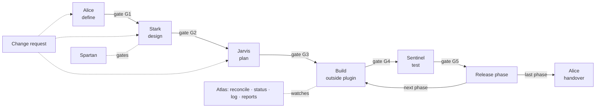

# ATLAS plugin: design

> The design ATLAS v1 was built from. What changed in v1.1 (automatic checks, begin/finish/pack, inferred progress, notes, the small track) is in [`CHANGELOG.md`](../CHANGELOG.md) and [`CONTRACT.md`](../CONTRACT.md) §0. The binding interface between agents is [`CONTRACT.md`](../CONTRACT.md); where the two differ, the contract and the code win. v1 notes: machine state is JSON (`atlas.json`, `state/*.json`, `log/events.jsonl`); recorded decisions are derived from the event log; generated views are Markdown. The plugin installs in both Claude Code (`.claude-plugin/`) and Codex (`.codex-plugin/`, `.agents/plugins/`).

---

## 1. What we are building

One Claude Code **plugin** containing a team of agents that takes a client project from first meeting to handover, with **Atlas** as the project manager that tracks everything and automates the routine parts.

**Principles**

1. **Derive, don't depend on memory.** Progress is recomputed from evidence (git, pull requests, CI, documents) every run. People forgetting to update records cannot make Atlas wrong.
2. **Never guess.** When evidence is ambiguous, Atlas asks once and remembers the answer (same rule as Alice).
3. **Proportion.** Rigour is set per module: heavy scrutiny where the risk is, light touch elsewhere.
4. **Append-only history.** Every meaningful event is logged and tamper-evident, like `.git`. The log *is* the tracker and the handover record.
5. **Agents are independent but share one contract.** Same IDs, same project storage, same event log. Any agent can run alone; Atlas picks up what happened.
6. **Extensible.** The flow is defined in a data file; adding an agent is a folder plus one row.
7. **Private by default.** Client material and internal notes never enter the code repo.

---

## 2. Agents and flow

| Stage | Agent | Produces | Interactive? |
|---|---|---|---|
| Orchestrate | **Atlas** | Status, reconcile, attention list, reports, event log | Light |
| Discover and define | **Alice** | PRD (internal), proposal, questions, sign-off record | Yes: asks the user |
| Design | **Stark** | Architecture, data model, API contracts, state machines, module rigour levels | Some |
| Plan | **Jarvis** | Phases, work packages, dependencies, agent briefs, audit of existing code | Little |
| Build | *(you, outside the plugin)* | Code in the code repo(s) | n/a |
| Test and release | **Sentinel** | Test plan from acceptance criteria, UAT script (client), go-live checklist | Little |
| Report and handover | **Alice** | Client progress updates, handover pack, closure | Little |
| Gates at every stage | **Spartan** | Pass / fail / waived, with reasons | No |

Tracking the build ("build and track") is **Atlas's job**. Jarvis only plans.



**Two loops:**
- **Per phase:** build, test and release repeat per phase. Phase 1 can be in testing while phase 2 is being built.
- **Change requests:** a change request goes back to Alice, then Stark, then Jarvis, touching only the affected items. The ID chain (§9) identifies those items.

---

## 3. Plugin layout

```
atlas-plugin/
├── .claude-plugin/plugin.json        # name, version, description
├── skills/
│   ├── atlas/     SKILL.md, references/, templates/
│   ├── alice/     (existing skill, moved in)
│   ├── stark/     (split out of JARVIS: TECHNICAL.md, design)
│   ├── jarvis/    (planning, briefs, audit)
│   ├── sentinel/
│   └── spartan/
├── lib/                              # ONE shared copy, used by every agent
│   ├── convert_docs.py               # PDF/DOCX/XLSX/PPTX/VTT → chunks
│   ├── register.py                   # ID register, trace, coverage
│   ├── atlasctl.py                   # state, event log, reconcile, gates, registry
│   ├── gitscan.py                    # incremental git / gh reader
│   ├── pdf_export.py                 # markdown → PDF (client files)
│   └── checks/                       # verify rules shared by agents
├── pipeline.md                       # the flow: stages, agents, inputs, outputs, gates
├── rigour.md                         # Light / Standard / Critical rules
├── gates.md                          # gate checklists per level
└── setup/                            # one-time install: venv, diagram renderer
```

- Skills reach the shared library as `<skill dir>/../../lib` — both Claude Code and Codex tell the agent where a skill lives, and the plugin is installed as a whole folder in both.
- Per-agent model and effort settings are not set in v1, because they are not portable between Claude Code and Codex. The session's model is used.
- Friends install the whole plugin in one step from a git-hosted marketplace.

---

## 4. Storage

### 4.1 Two modes, chosen once per device

| | GitHub mode (recommended) | Folder mode |
|---|---|---|
| Setup | `/atlas setup`, then the user logs in to GitHub themselves via `gh` | `/atlas setup`, then the user pastes a projects path |
| Per project | One **private repo** | One folder under that path |
| Sync | Atlas pulls before and pushes after each run | The folder's own sync (Dropbox, iCloud, shared drive…) |
| Registry | A private `atlas-registry` repo | `<projects path>/REGISTRY.md` |

- The same internal structure is used in both modes. `/atlas migrate --to github` moves a project between them.
- Atlas never stores credentials. GitHub auth stays with `gh`.
- Device config lives in `~/.atlas/config.md`: mode, projects path or GitHub owner, and local clone locations.

### 4.2 Project identity

- ID format: `PRJ-0001`, issued by the registry, never reused.
- Each project's `project.md` records:
  - ID, name, client, size class and current phase;
  - the code repo URL(s): Atlas reads them and **never writes to them**;
  - storage mode and the location of the client outbox.

### 4.3 Inside one project's private storage

```
PRJ-0007-<name>/
├── atlas.json               # identity + links (machine)  ·  project.md (generated)
├── log/events.jsonl         # append-only event log (§5)
├── snapshots/               # documents frozen at milestones, by hash
├── state/
│   ├── mapping.json         # learned file→module / WP answers
│   └── reconcile.json       # last reconcile: branch tips, evidence, PRs, CI
├── discovery/               # Alice: sources, _work/, PRD.md, PROPOSAL.md, QUESTIONS.md
├── design/                  # Stark: TECHNICAL.md (+ modules)
├── plan/                    # Jarvis: PLAN.md, briefs/, AUDIT.md
├── test/                    # Sentinel: TEST-PLAN.md, UAT.md, GO-LIVE.md
├── reports/                 # status reports, client updates, HANDOVER.md
└── views/                   # generated: STATUS.md, TIMELINE.md (never edited by hand)
```

### 4.4 Client outbox

- Client-facing files go to `~/Desktop/PRJ-0007-<name>-for-client/` as **PDF**: the proposal, questions, progress updates, UAT script and handover pack.
- The project name is in the header. No company branding in v1.
- Mermaid diagrams are rendered to images before the PDF is built.
- The internal PRD, design and plan are **never** exported by default.

---

## 5. Event log (the built-in tracker)

- One line per event in `log/events.jsonl`. It is only ever appended to: never edited, never deleted.

```json
{"seq":42,"ts":"2026-11-13T14:02:11Z","actor":"alice","by":"user","type":"doc.version",
 "refs":["PRD@v0.3","M03"],"summary":"PRD v0.3: 4 new FRs, 2 questions answered",
 "data":{"fr_added":4,"q_closed":["Q-004","Q-007"]},"prev":"9f1c…","hash":"c27a…"}
```

- **Tamper-evident:** `hash = sha256(prev + event)`. `atlasctl verify-log` detects any edit, gap or reorder.
- **Merging across devices:** events carry a device ID and a timestamp. Atlas merges logs by timestamp and re-chains after a sync merge. A short write lock (`state/.lock`, with expiry) prevents two devices writing to the same project at once.
- **Event types (v1):**
  - **Project and phases:** `project.created`, `stage.started` / `stage.finished`, `phase.released`.
  - **Documents:** `doc.version`, `snapshot.taken`.
  - **Approvals and decisions:** `signoff.recorded`, `decision.recorded`, `gate.passed` / `gate.failed` / `gate.waived`.
  - **Change requests:** `cr.opened` / `cr.approved` / `cr.done`.
  - **Tracking:** `rigour.set`, `reconcile.run`, `drift.resolved`, `mapping.learned`.
  - **Client communication:** `report.sent`.
- **Snapshots:** at sign-off, gate pass and release, the relevant documents are copied to `snapshots/<hash>/` and referenced from the event. This answers "what exactly did the client approve?"
- **Generated views:**
  - `STATUS.md`: now;
  - `TIMELINE.md`: the history;
  - `HANDOVER.md`: built, decisions and why, open items, risks.

---

## 6. Reconcile: keeping state true without manual updates

`/atlas` runs a reconcile first:

1. **Incremental scan.** `gitscan.py` fetches each code repo and reads only the commits and pull requests since the SHA saved in `state/reconcile.md`, plus CI status via `gh`. It hands the model a compact summary, never raw history.
2. **Match each change to a work package:**
   1. a `WP-07` or `FR-012` style ID anywhere in the branch, commit or pull request title gives an exact match;
   2. otherwise, file paths are matched to modules from `design/` and `state/mapping.md`;
   3. otherwise, the change is queued as a question; the answer is saved with `mapping.learned`, so the same question is never asked twice.
3. **Assign a confidence level:**
   - *verified:* tests or acceptance checks pass;
   - *likely:* code exists and matches the spec;
   - *claimed:* someone said it's done.
4. **Report drift. Never fix silently.** Examples:
   - "WP-07 is marked not started, but 14 commits touched it. Mark it in progress?"
   - "12 commits match no work package. Is this unplanned work, a change request, or a bug fix?"
   - "The spec says X, but the code does Y."
5. **Record the result:** a `reconcile.run` event, with `state/reconcile.md` updated with the new SHAs.

Collaborators need nothing installed and follow no rules. Jarvis's briefs *suggest* branch names, so exact matching happens naturally when briefs are used.

---

## 7. Atlas commands

| Command | Does |
|---|---|
| `/atlas setup` | Choose a mode, connect GitHub or set the projects path, install dependencies |
| `/atlas new <name>` | Issue a project ID, create storage, register the project, ask for the author and code repo(s) |
| `/atlas` or `/atlas status` | Reconcile, then show status per phase and module, slippage, attention list (Critical first) and the suggested next step |
| `/atlas projects` | All projects at a glance from the registry |
| `/atlas run <stage>` | Run a non-interactive stage in a separate context (gate, test plan, re-plan) and return a summary |
| `/atlas log [filter]` | Timeline, filterable by module, phase, agent or type |
| `/atlas show <ID>` | Full story of one item (CR-03, WP-07, FR-012, Q-004) |
| `/atlas cr "<change>"` | Open a change request, run the impact analysis, route it to Alice/Stark/Jarvis |
| `/atlas gate <G#>` | Run a Spartan gate. Waiving needs a recorded reason |
| `/atlas report [internal\|client]` | Internal status report, or a client update drafted via Alice and exported as PDF |
| `/atlas handover` | Generate the handover pack and export it as PDF |
| `/atlas migrate --to github` | Move a folder-mode project to GitHub |

**Interactive stages run in your own session.** Atlas tells you "run `/alice` now" rather than hiding the questions inside a separate context.

**The attention list includes:**
- failing CI;
- stale pull requests;
- blocked work packages;
- client questions unanswered for more than N days;
- pending gates;
- unplanned work;
- scope creep;
- slippage against the phase plan;
- Critical modules lacking verified evidence.

---

## 8. Rigour levels (per module)

- The project size class sets the default. Each module can then be raised or lowered.
- **Stark proposes each level** from these signals, with the reasons:
  - money;
  - personal or health data;
  - auth and permissions;
  - outside integrations;
  - many states;
  - regulation;
  - many requirements;
  - many dependents.
- **You confirm**, and the level is recorded as a `rigour.set` event.
- **A change request that adds a signal** (e.g. payments) triggers a prompt to raise the level.

| | Light | Standard | Critical |
|---|---|---|---|
| Stark spec | Description and acceptance criteria | Data model, flows, API contracts | Full state machines, edge and failure cases, threat notes, rollback |
| Jarvis plan | 1–2 work packages | Normal work packages | Small work packages with review checkpoints |
| Atlas "done" means | Code exists and matches (likely) | Tests pass (verified) | Verified, acceptance criteria checked one by one, and user sign-off |
| Spartan | Basic checks | Standard list | Full list, plus security review of every change touching it |
| Sentinel | Smoke test and UAT step | Unit and integration tests on the main paths | Edge, failure and end-to-end tests, migration rehearsal |

**Check styles by agent:**
- **Technical agents (Stark, Sentinel, Spartan)** run strict structural checks.
- **Writing agents (Alice's proposal, reports, handover)** run plain-language checks: no jargon, no internal IDs, no promises the PRD doesn't support.

---

## 9. ID chain (the shared contract)

```
M/d (source) → FR (Alice) → REQ/AC (Stark) → WP (Jarvis) → commits/PRs (reconcile) → TEST (Sentinel) → release (Atlas)
                       CR-## touches any link → impact = everything downstream of it
```

- **IDs are issued only by `lib/register.py`.** They are never reused, and each kind has one owner.
- **Every downstream item cites its upstream ID.** A Spartan check fails if a link is broken: an FR with no AC, a WP with no FR, a Critical AC with no test.
- **Change-request impact analysis** is a graph walk over this chain, so only the affected items are re-planned.

---

## 10. Gates (v1)

| Gate | Light | Standard adds | Critical adds |
|---|---|---|---|
| **G1 Alice → Stark** | Client sign-off recorded; no "needed before we start" questions open | All FRs have a status; regulations section reviewed | Legal flags acknowledged by the user |
| **G2 Stark → Jarvis** | Every in-scope FR has acceptance criteria; rigour levels confirmed | Data model and API contracts consistent | Threat notes and failure/rollback behaviour for Critical modules |
| **G3 Jarvis → Build** | Every FR is covered by a work package; no dependency cycles | Phases have exit criteria | Review checkpoints placed in Critical work packages |
| **G4 Build → Test (per phase)** | Phase work packages done or explicitly deferred; CI green | No unreviewed drift | Security review of changes touching Critical modules; no secrets in the repo |
| **G5 Test → Release (per phase)** | UAT passed with client sign-off | Go-live checklist done | Rollback plan rehearsed; migration rehearsed |

- **Possible results:** pass, fail (with reasons), or **waived** (the user plus a reason, logged).
- **Rule:** scripted where possible; otherwise a yes/no question to the user. Never a vague "risk review".

---

## 11. Agent contract and extending the flow

**`pipeline.md`** defines the flow as rows:

| Stage | Agent | Needs | Produces | Gate after | Interactive |
|---|---|---|---|---|---|
| define | alice | sources in discovery/ | PRD, PROPOSAL, QUESTIONS | G1 | yes |
| design | stark | PRD ≥ signed-off | TECHNICAL, rigour levels | G2 | some |
| … | | | | | |

**Every agent must:**
- read and write only its own folder, plus `log/` through `atlasctl`;
- emit `stage.started` and `stage.finished` events;
- cite upstream IDs;
- pass its own checks before finishing.

**To add an agent:** add its skill folder, plus one row in `pipeline.md`, plus (optionally) gate rows. Atlas reads the pipeline file, so no code changes are needed.

---

## 12. Security

- **Separation:** client material and internal documents live in private project storage, never in code repos. Code repos are read only.
- **Least privilege:** one private repo per project, so access is granted per client and data can be deleted per contract.
- **No credentials in state.** GitHub auth goes through `gh`. Spartan checks state and code repos for leaked secrets.
- **Tamper-evident log;** snapshots prove what was approved.
- **Web research never includes client-identifying data** (existing Alice rule, applied to all agents).
- **Later:** encryption of sensitive files (raw transcripts) inside the project repo.

---

## 13. Migration from today's skills

| Today | Becomes |
|---|---|
| `~/.claude/skills/alice` | `skills/alice`, writes to `discovery/`, emits events, adds a sign-off record and the handover/report modes |
| `~/.claude/skills/jarvis` (TECHNICAL.md part) | `skills/stark` |
| `~/.claude/skills/jarvis` (PLAN, briefs, audit) | `skills/jarvis` |
| Two copies of `convert_docs.py`, plus separate venvs | `lib/convert_docs.py`, one shared venv |
| `STATE.md` per skill | `state/` and `log/` in project storage |

Existing standalone skills stay usable until the plugin is proven.

---

## 14. Build order (v1)

1. **Foundation:**
   - plugin skeleton and shared `lib/`;
   - `atlasctl` (registry, project storage, event log with hash chain, lock);
   - `/atlas setup` and `/atlas new` for both modes.
2. **Atlas core:** `gitscan` incremental reconcile, matching tiers, drift questions, `STATUS.md` and `TIMELINE.md`, `/atlas status`, `log` and `show`.
3. **Move Alice in:** new paths, events, sign-off record, and PDF export to the client outbox.
4. **Split Stark out of Jarvis.** Add rigour levels. Jarvis reads Stark's output.
5. **Spartan:** G1–G5 scripted checks, plus waivers.
6. **Sentinel:** test plan from acceptance criteria, UAT PDF, go-live checklist.
7. **Change requests:** impact walk, partial re-plan.
8. **Alice reports and handover:** client update and handover PDF.
9. **Test end to end on one real project,** then adjust.
10. **Open-source release:**
    - publish the plugin repo publicly, with a licence, README and marketplace entry;
    - clean out personal paths, emails and sample client data;
    - deliver as a zip at `~/Downloads/atlas-plugin.zip` containing a ready git repo: initial commit made, `.gitignore` in place, no `.venv`, no remote set. On the personal laptop: unzip, `git remote add origin <url>`, `git push -u origin main`;
    - add a one-page static **`docs/index.html`** for GitHub Pages explaining how it works (flow diagram, agents, tracker, rigour levels), how to install and set it up (GitHub or folder mode), and a walkthrough of one project from `/atlas new` to handover.

You can use the plugin after step 2. Each later step adds one capability.

---

## 15. Risks and open items

- **Platform details:** install flow verified for Claude Code (`claude plugin marketplace add` + `install atlas@atlas`) and Codex (`codex plugin marketplace add` + `add atlas@atlas`).
- **PDF toolchain:** markdown to PDF, plus Mermaid rendering, needs one-time installs. Setup must handle them and fail clearly if they're missing.
- **Folder mode with sync services:** conflicts are possible. The append-only log, re-chaining and the lock mitigate this, but GitHub mode is safer.
- **Reconcile accuracy without IDs:** file matching is weaker for cross-cutting changes. "Ask once and remember" is the safety net.
- **Token cost:** kept low by incremental scans, script-side summarising and separate contexts for batch stages. To be measured on the first real project.
- **Not yet tested together:** Alice and Jarvis have each had one full test run. Step 9 is mandatory before calling v1 done.
