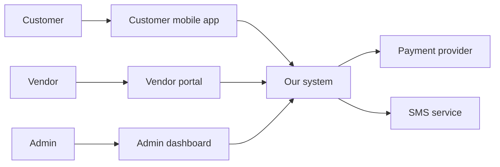
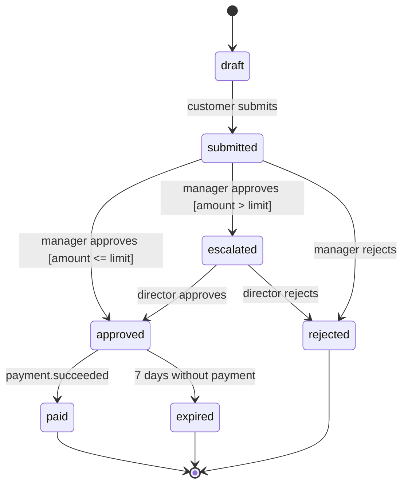
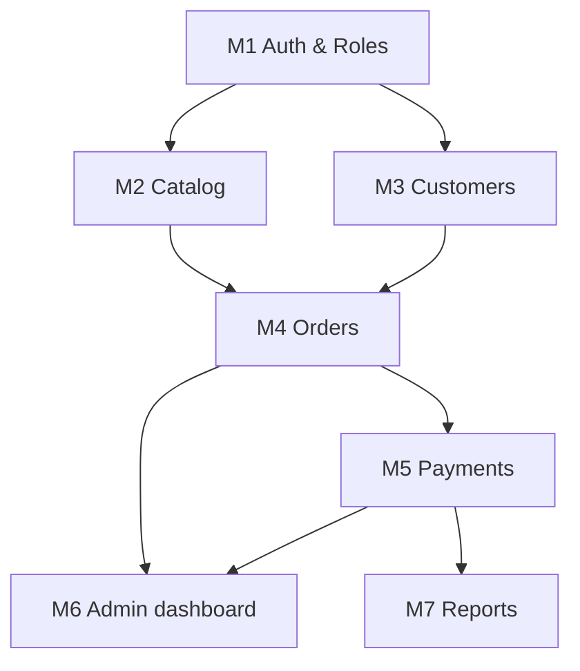
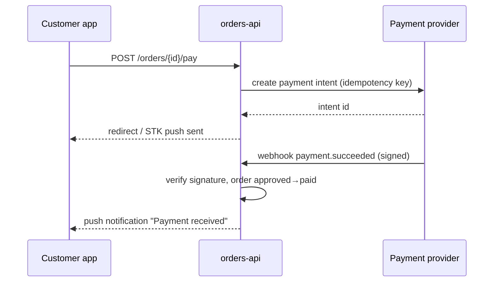

# Diagram guide (Mermaid)

All diagrams are Mermaid code blocks inside the markdown. They render on GitHub, GitLab, VS Code (with the Markdown Preview Mermaid extension), Obsidian, and Notion, and any agent can read and edit them.

## Two styles

| | Overview style | Technical style |
|---|---|---|
| Labels | Plain words ("Customer app", "Pay for order") | Precise identifiers (`orders-api`, `payment.succeeded`) |
| Size | ≤ 12 nodes; split into several diagrams if larger | As many as needed, but split by module if > ~25 nodes |
| Detail | What and who | How, with protocols, guards, side effects |

## Which diagrams, where

| Diagram | Mermaid type | OVERVIEW | TECHNICAL | Required from |
|---|---|---|---|---|
| System context (people, platforms, external systems) | `flowchart LR` | ✅ simple | ✅ detailed | Small |
| Build order / module dependencies | `flowchart TD` | ✅ phases | ✅ module graph | Small |
| Data model | `erDiagram` | — | ✅ | Small |
| State machine per stateful entity | `stateDiagram-v2` | ✅ main 1–3, plain labels | ✅ all | Small |
| Main processes / use-case flows | `flowchart` | ✅ | optional | Small |
| Containers / components | `flowchart` with subgraphs | — | ✅ | Medium |
| Sequence of critical flows (payments, auth, integrations) | `sequenceDiagram` | — | ✅ | Medium |
| Deployment / infrastructure | `flowchart` with subgraphs | — | ✅ | Large |
| Delivery timeline | `gantt` (phases only, no dates unless given) | optional | optional | — |

## Syntax rules (avoid render errors)

- Quote labels that contain spaces, punctuation, or parentheses: `A["Admin dashboard (web)"]`.
- Node IDs: letters, digits, underscores only — no spaces or hyphens (`admin_web`, not `admin-web`).
- In `stateDiagram-v2`, state names must be single words; use `state "Awaiting payment" as awaiting_payment` for readable labels.
- Transition labels: `pending --> approved : manager approves`. Avoid colons inside the label text.
- In `erDiagram`, entity names in UPPER_SNAKE or PascalCase, no spaces; attributes as `type name PK|FK|UK "comment"`.
- Don't use `end` as a node ID (reserved). Avoid `<`, `>`, `{`, `}` inside unquoted labels.
- One diagram per code block.

## Examples

### System context — overview style

### State machine — technical style

Always pair a technical state diagram with a transition table (from, event, actor, guard, to, side effects, REQ).

### Build order — technical style

### Sequence — technical style

