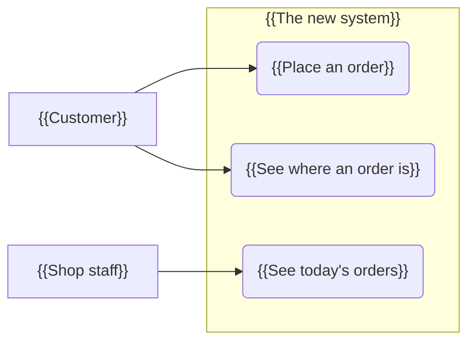
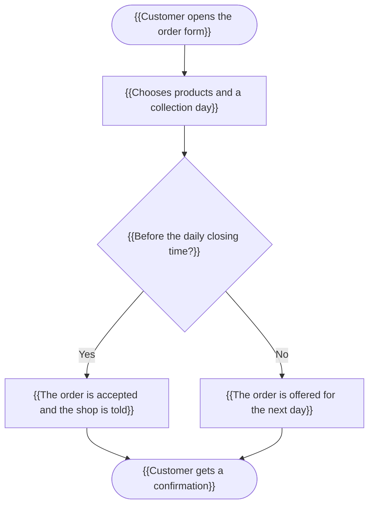
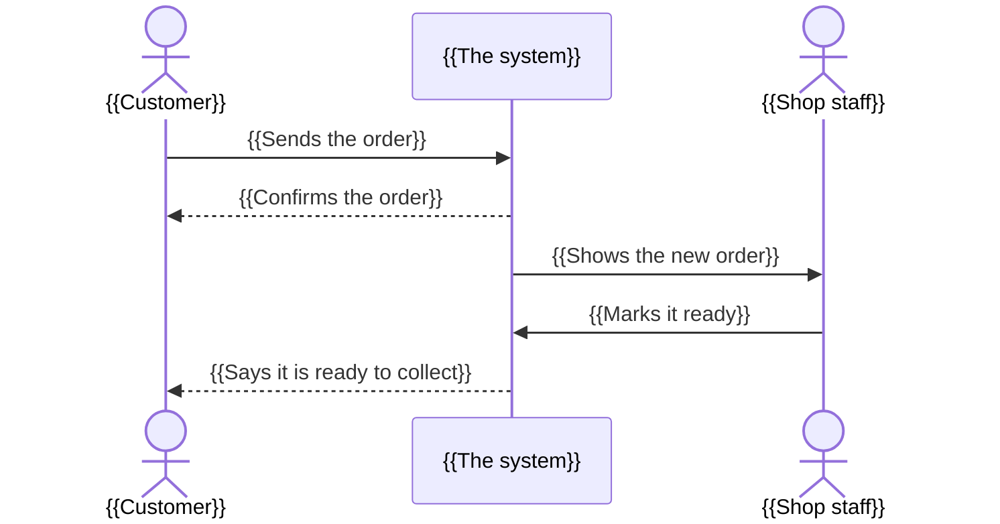
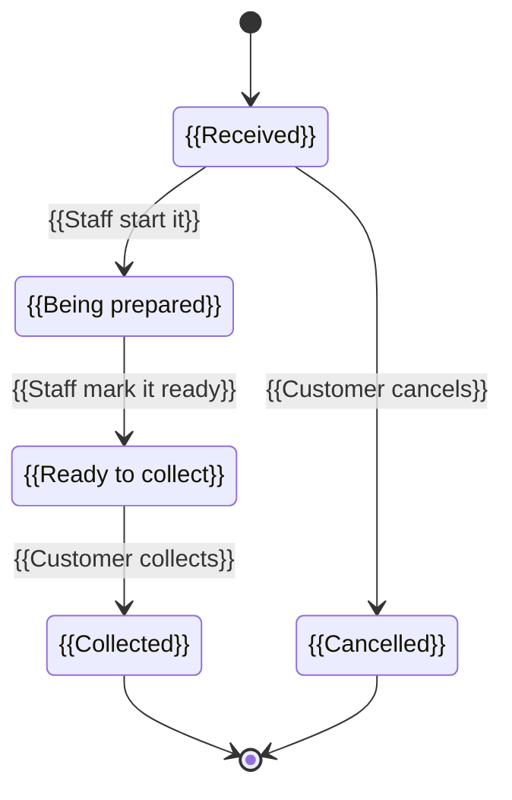
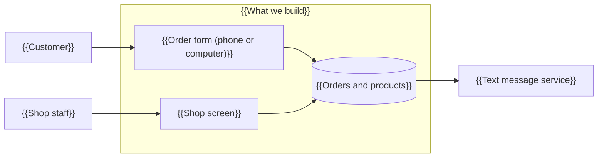

# {{Project name}} — How the system will work

| Prepared for | {{Client}} |
|---|---|
| Prepared by | {{author}} |
| Version | {{v1.0 — YYYY-MM-DD}} |
| Based on | {{the requirements agreed on YYYY-MM-DD}} |

<!-- TEMPLATE NOTE — delete before finishing. Readers: the client and people who are not engineers. Plain words
everywhere, the proposal's vocabulary, the same name for the same person, record and step in every picture.
No internal IDs (FR-, REQ-, M1 …) in a label or in the text; to remember what a picture covers, add a comment under it
such as `covers: FR-001, FR-004` inside an HTML comment (comments are not printed).
Every picture has its "What this picture shows" sentence ABOVE it; no caption under it.
Keep only the sections this project needs and renumber them 1, 2, 3 … — a Small project has 3–4 pictures
(usually sections 1, 2 and 5, plus 6 when outside services matter), a Medium or Large one all six.
Draw only what the requirements say. One picture fits one page: about 15 boxes at most, otherwise split it. -->

{{Two or three sentences: these pictures show how the system will work once it is built, drawn from what we agreed. Each one starts with a sentence saying what it shows.}}

## 1. Who uses the system, and for what

{{One or two sentences: the people involved and how they differ.}}

**What this picture shows:** {{one sentence — e.g. the three kinds of people who use the system and what each of them comes to do.}}



## 2. How the work will flow

{{One sentence: which workflows are shown and why these are the ones that matter.}}

### 2.1 {{Workflow name — e.g. Taking an order}}

**What this picture shows:** {{one sentence — e.g. what happens from the moment a customer orders until the order is ready.}}



## 3. Who talks to whom

**What this picture shows:** {{one sentence — e.g. the messages that pass between the customer, the system and the shop when an order is placed.}}



## 4. The information it keeps

**What this picture shows:** {{one sentence — e.g. the records the system keeps and how they belong together.}}

```mermaid
classDiagram
    class Customer {
        {{Name}}
        {{Phone number}}
    }
    class Order {
        {{Collection day}}
        {{Status}}
    }
    class OrderLine["{{Order line}}"] {
        {{Product}}
        {{Quantity}}
    }
    Customer "1" --> "many" Order : {{places}}
    Order "1" --> "many" OrderLine : {{contains}}
```

## 5. The life of {{an order}}

**What this picture shows:** {{one sentence — e.g. the stages an order goes through, and what moves it from one to the next.}}



## 6. The parts of the system

**What this picture shows:** {{one sentence — e.g. the pieces we will build, who uses each, and the outside services they rely on.}}



## Changes to this document

| Version | Date | Change |
|---|---|---|
| v1.0 | {{YYYY-MM-DD}} | First version |
